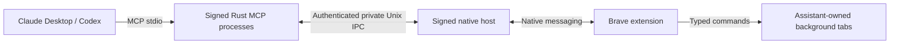

# Brave Isolé

**Let Claude Desktop and Codex work in Brave while you keep using your browser.**

A free, open-source MCP bridge for macOS. It uses your existing Brave profile and signed-in sessions, with separate background tabs for each assistant role.

**Developer preview.** Source installation, local signing and manual extension setup are required. There is no one-click installer, browser-store listing or notarized binary download yet. The current activation procedure requires both Claude Desktop and Codex desktop.

## What it does

- Opens and operates background tabs in the visible **Claude** and **Codex** groups. It does not automatically attach your personal tabs.
- Keeps your existing site sessions. No password entry, profile copy or cookie import is needed by the bridge.
- Offers 11 typed tools: open, list, close, navigate, snapshot, screenshot, click, fill, scroll, wait and page JavaScript.
- Reconnects when Brave starts. **Stop** revokes control and remembers the pause; **Connect** resumes automatic connection.
- Separates the Claude and Codex roles. A fresh session cannot reuse old handles. Different chats within the same role share that role's tabs.

## Local transport, an OS sandbox, explicit limits

The Rust processes run under **macOS App Sandbox when launched from the locally signed app bundle**. MCP uses stdio, the browser uses native messaging, and the local processes communicate through private authenticated Unix IPC. The production bridge has **no TCP listener, telemetry or hosted relay**.

The tool API has no host shell, arbitrary host filesystem endpoint, raw CDP endpoint or dedicated cookie-export endpoint. JavaScript executes in a browser page. The extension's debugger permission is still powerful, and page scripts retain their web capabilities.

**This does not make the full workflow offline or risk-free.** Websites contact their servers. Text and screenshots returned to an online assistant can reach that provider. The sandbox does not contain the whole assistant or its other tools, and does not deny every public system file. Normal confirmations for consequential actions still apply. See [SECURITY.md](SECURITY.md) for the threat model and tested boundaries.

## Install from source

Requires macOS, Brave, Claude Desktop, Codex desktop, Rust 1.88+, Node.js 22+ and Python 3.11+. Initial local validation was performed on Apple silicon, macOS 27.0.1. Older macOS versions and Intel hardware are not certified by this release.

```sh
git clone https://github.com/Mozzzaic/brave-isole.git
cd brave-isole
cargo fmt --check
cargo clippy --all-targets -- -D warnings
cargo test
node --test extension/tests/*.test.mjs
python3 -m unittest discover -s tests -p '*_test.py'
```

Then follow the [installation guide](docs/install.md), including signing, confinement checks and the real-application activation gate. **Do not configure the bare `cargo build` executable as your browser bridge:** it is a test build, not the confined app bundle.

The bridge is free under the [MIT license](LICENSE). Assistant services and their account requirements are separate.

## Architecture



MCP and native processes share the app's private container. No bridge-owned cloud account is required. The release includes reproducible tests, not a claim of independent certification or absence of unknown vulnerabilities.

## Use it by default

After installation, paste the [routing instruction](docs/assistant-instructions.md) into your assistants' permanent instructions. Disable competing Brave-control connectors so they do not select AppleScript or native keyboard control instead. A prompt preference is guidance, not a system-wide security policy.

The bridge does not ask Brave to take focus. A site may still open a dialog or popup. Cross-origin subframes, child-tab workflows and file pickers are limited; the assistant must report missing capabilities instead of silently changing control tools.

## Contribute

Bug reports and small, tested pull requests are welcome. Start with [CONTRIBUTING.md](CONTRIBUTING.md). Please report security issues privately using [SECURITY.md](SECURITY.md). No private account data, cookies, machine receipts or screenshots belong in an issue.
